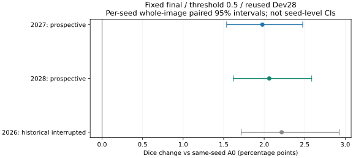
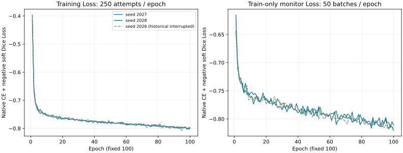

# nnU-Net 100 epochs 成果复盘（2026-10-27）

**结论：预先固定的两个新增种子均复现约 2 个百分点的普通 Dice 收益，但严格保护尚未通过。** 这是整套训练流程在反复使用的 MAPLES-DR Dev28 上的探索比较，不能单独归因于网络结构，也不是独立或临床验证。

任务：[Issue #9](https://github.com/Yileina-Monv/retinal-vessel-study/issues/9)。原 U-Net 阶段报告仍在 [PR #7](https://github.com/Yileina-Monv/retinal-vessel-study/pull/7)，本 PR 不复制其成果包、不取代旧正式 T0/TW 负面结论，不修改其他 PR。当前报告由 AI 辅助完成科研复盘及 CPU 数值核验，尚待组员真实人工审阅。

## 主要结果

|轨迹|对应 A0 Dice|nnU-Net Dice|差值（百分点）|差值的图像配对95%区间|
|---|---:|---:|---:|---|
|2027（预定连续复现）|83.6446%|85.6225%|+1.9779|[+1.5365, +2.4751]|
|2028（预定连续复现）|83.6273%|85.6899%|+2.0626|[+1.6181, +2.5866]|
|2026（历史中断接续，仅参照）|83.5063%|85.7221%|+2.2158|[+1.7179, +2.9266]|

2027/2028 的 Dice 差值均值为 **+2.0202 个百分点**，样本标准差 **0.0599 个百分点（n=2，ddof=1）**；2026 不参与此汇总。两个新增种子分别有 27/28、28/28 张图 Dice 提高，全部图片均保留。这种重复方向支持当前 Dev 上的流程收益，但两个种子不等于充分证明种子稳定性，更不能把同一 Dev 的两次使用说成 56 张独立图片。



## 保护和细血管解释

下表全部为 NNUNET−各自 A0 的图像宏平均差值，单位为百分点；FP/FOV 越低越好，其余指标越高越好。

|指标|seed2027 差值 [95%区间]|seed2028 差值 [95%区间]|
|---|---:|---:|
|Precision|-0.1142 [-1.1101, +1.0886]|+1.3218 [+0.2994, +2.5380]|
|Recall|+3.7544 [+2.7349, +4.7636]|+2.5811 [+1.6018, +3.5237]|
|FP/FOV|+0.1058 [-0.1070, +0.2926]|-0.1642 [-0.3950, +0.0250]|
|hard-clDice|+2.4392 [+1.9586, +3.1199]|+2.5043 [+1.9911, +3.1316]|
|细血管候选路径召回 d1，图像宏平均|+7.6278 [+5.8453, +9.3767]|+5.7575 [+3.8130, +7.5915]|
|远处 Recall|+3.6845 [+2.6359, +4.6956]|+2.5628 [+1.5685, +3.5053]|
|粗血管 d0|+0.4308 [+0.1017, +0.8184]|+0.3319 [+0.1238, +0.5597]|

2027 的 Precision 均值略降、FP/FOV 均值略升，相关区间均跨零：存在不利均值方向，但不能称已证实误报增加。2028 所有预定保护均值方向有利，Precision 区间也为正，但 FP 区间上界仍为正，尚不能证明严格不劣。两条的严格保护结论均为 **未通过**，不能以 Dice 和 Recall 提高宣布全面成功。自动 `DICE_SIGNAL_WITH_PROTECTION_COST` 标签只是规则输出，不替代对均值与区间的上述区分。

细血管路径召回、hard-clDice、远处及粗血管指标方向一致改善。原病灶邻域 9 张有效图、77 个位置及 19 个位置 NA 的定义保持；31 指标另有自身有效图名单，不能混同“18 张/9 张有效图”与邻域位置数。每种方法、每个种子有 48 个逐图指标 NA，保持原状态而非补零。

## 实际协议与比较边界

|项目|nnU-Net|对应 A0|
|---|---|---|
|网络与初始化|官方 2D PlainConvUNet，独立随机初始化|原 U-Net，从共同 M0 10000 步预训练权重开始|
|Loss|标准 softmax CE＋负 soft Dice，官方深监督|原 BCE＋未加权 masked Dice|
|优化器|SGD，初始 LR 0.01，momentum 0.99，Nesterov，weight decay 3e−5，clip 12|AdamW，LR 1e−4，weight decay 1e−4，clip 1|
|预算|100 epochs，每 epoch 250 次尝试及 50 次 Train-only 监控；Poly100|固定 2000 次成功更新，无 scheduler；M0 预训练费用另计|
|输入|batch 2，1024×1536 patch，原生增强及前景过采样|batch 4，512×512 patch，原四裁块和几何增强|
|归一化与监督支持|原生逐图逐通道 ZScore、原生背景/裁剪填充监督，不加项目 FOV Loss mask|原冻结通道统计及 FOV mask|
|数据与外部评价|Train110、Dev28、fold all；原冻结 GT/FOV/有效名单|相同 Train/Dev 划分和外部评价定义|
|终点|唯一 checkpoint_final，阈值 0.5；原生逆变换、Gaussian tile step0.5，无 TTA/集成/后处理|复用各自 seed 原 2000 步概率与固定 0.5，不新增推理|

因此，这不是固定所有条件、只换架构的消融，也不是同 GPU 时长或总训练成本的公平比较。不能以 A0 的“2000”忽略 M0 预训练，亦不能把 100 epochs 的结果称为 nnU-Net 充分收敛上限。

版本：nnunetv2 2.8.1、PyTorch 2.4.0+cu121、batchgenerators 0.25.3、batchgeneratorsv2 0.3.5；plans 和输入清单摘要见配置及来源表。nnU-Net 是作者框架，本项目不将其作为原创模型方法。

## 完成计数、Loss 与历史异常

|轨迹|训练尝试|实际成功更新|安全 AMP 跳步|Train-only监控|训练进程时间|
|---|---:|---:|---:|---:|---|
|2027|25000|24993|7|5000|12.29 小时|
|2028|25000|24994|6|5000|12.35 小时|
|2026|25000|24994|6|5000|11.56 小时（仅 V5 接续进程，非总成本）|

2027→2028 按预定顺序连续完成，两条训练与推理进程退出码均为 0；没有依据第一条成绩取消第二条，也没有给安全跳步补步。两条训练进程合计约 24.63 小时，终点推理时间另列配置表；这不是整项工程所有历史失败的总费用。

2026 的前 1000 次与后 24000 次尝试组成历史轨迹；主状态已恢复，但原生增强队列重建，因此不是逐位精确的未中断轨迹。其原训练进程在 final 保存后因增强器清理类型错误退出 1，后来经既有 CPU 审查完成只评价恢复，新增训练为 0。原错误与已消耗费用保留。2026 根目录没有单独的推理进程时间收据，本包该字段留空，不伪造为 0。



公开 Loss 是原记录中有限的原生 CE＋负 soft Dice，总 Loss 为负不等于数值异常。75000 行保留全部尝试与 AMP 跳步标识，另有 300 行逐 epoch 汇总；实线为新增连续轨迹，灰色虚线为历史轨迹。Train-only 监控不是 Dev 验证曲线，不能用它挑 checkpoint；不同方法的 Loss 定义不同，不能直接比较原始 Loss 大小。

继承的每种子冻结协议中仍有旧 seed2026 的说明文字。本次使用实际初始化记录、实际增强种子池、对应 A0 配置/收据及完整 31 指标 fixture 逐项核实 2027/2028，未改写旧协议：2027 的训练/监控 worker 种子为 2027/2028，2028 为 2028/2029，各一 worker。

## 可复核程度和公开边界

本次 CPU 审查独立复算三个种子各 31 项均值及原图像配对区间，最大误差为 0；公开标准库脚本复算容差为 1e−12。原 bootstrap 为每种有效图数独立重启 PCG64(20261016)，1000 次整图配对重采样，linear 2.5%/97.5% 分位数。保存原索引及逐指标图片顺序，不重抽有利区间。

在私有原件侧核查了 84 张 nnU-Net 终点概率的文件 SHA、原生 shape、float32、有限性及 [0,1] 范围；新增两种子的 56 张既有 A0 概率亦核查指纹与范围。2026 A0 采用既有科研复盘、配置和终点记录，本次不冒称重新验证其全部原概率。30 个运行源码指纹和读取期间来源文件均未变。公开仅包含这些核验收据和数表，不含任何像素或数组。

数表共有 5208 个逐图指标位置（含 288 NA）、2460 条有效配对差值、93 组区间；两个新增种子的 31 项均值和样本 SD 单独汇总。比例指标以 0–1 存储；其他量保留原单位，不能把所有 31 项都转成百分点。

复算命令：

```bash
python -B scripts/verify_nnunet_results_export.py
```

无需图像、模型、GPU 或第三方 Python 包即可复算公开统计；不能由此证明训练可独立重启、图像指标定义实现正确或临床有效。完整运行分支、数据资产、权重与概率不公开，本仓库仍是证据入口而非完整训练资产镜像。人工医学审核未完成，AI 科研判读不冒充人工判断。

文件入口：[成果包与字段说明](../../outputs/nnunet_replication_20261027/README.md)、[全部配对统计](../../outputs/nnunet_replication_20261027/paired_comparison_summary.csv)、[逐图指标](../../outputs/nnunet_replication_20261027/fixed_endpoint_per_image_metrics.csv)、[来源及 CPU 核验](../../outputs/nnunet_replication_20261027/source_audit.json)。官方 Test60 继续封存；本次复盘和发布新增训练/模型推理为 0，不自动扩种子、步数或实验组。
