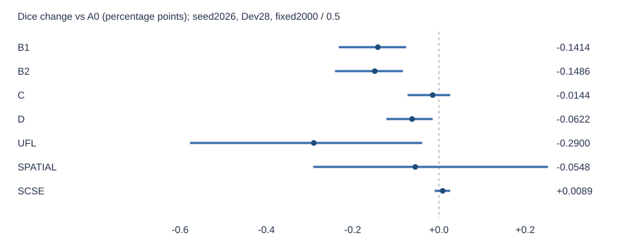
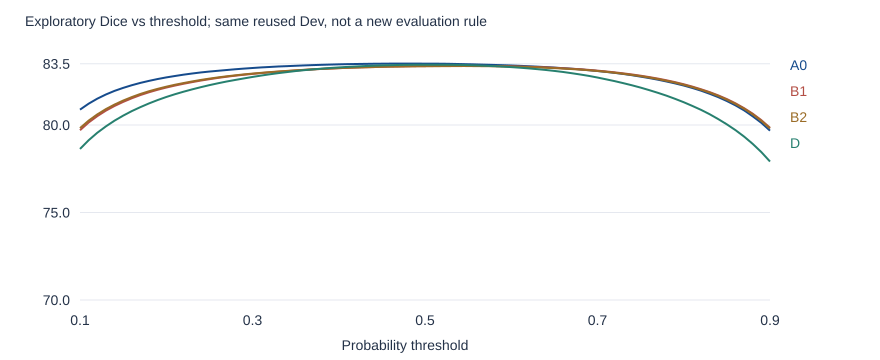

# 视网膜血管分割阶段探索总结

**从区域加权到结构监督、损失与模块研究｜截至2026-10-26｜供组长阶段审阅**

## 一页结论：我们做了什么，得到什么？

我们没有只训练一个新模型然后挑选有利指标，而是沿着“病灶邻域是否需要额外关注→细分支监督是否有效→误报从哪里来→是否只是阈值问题→训练覆盖与模块是否能改善”逐步检验假设。

**目前这批原U-Net探索中，尚未找到同时满足原定效果与保护条件的改进。** 这不是没有研究进展：实验明确显示，找回更多细分支不一定提高整体分割质量，降低误报也可能伴随漏检增加。当前不能据此宣称所有Loss、所有注意力模块或原U-Net都没有改善空间。

- 前期正式T0/TW三种子实验、权重1.5/3.0、类别定向2/1与4000步预算探索均已完成；未获得可靠且受保护的区域加权增量。旧正式结论保持不变。
- B1/B2确实提高细分支召回，但Precision下降、FP增加、Dice与hard-clDice下降。
- C soft-clDice使结构指标略有改善，但普通Dice未获得可靠改善；D Focal BCE＋Dice和完整非对称UFL也没有改善普通Dice。
- 空间分层采样降低FP，却损失Recall和细分支覆盖；单scSE只有约0.009个百分点Dice均值变化，区间跨零。
- 现有阈值与Train覆盖诊断不支持“只差一个更好阈值”或“大部分细分支没有参加训练”这两种简单解释。

**本报告仅汇总已完成的原U-Net研究；独立模型旁支不纳入此次上传。** 所有后续新实验需另行批准，本次报告本身不授权训练。

## 1. 研究口径与公平对照

数据为MAPLES-DR固定Train110/Dev28；官方Test60继续封存，不用于本轮选型。A0是原T0的seed2026、2000次成功更新终点，后续表格均与这一基线比较，不与三种子均值混用。Dev是反复使用的开发集，不是独立测试集。

后续探索均从同一FIVES预训练M0独立开始，固定seed2026、2000次成功更新、batch4、原生512×512裁块、AdamW学习率1e-4与原增强规则。A0结果只读复用，不为新方法重训；其Dice为83.5063%。Loss/骨架组保留原图序、裁块和增强；空间分层组有意改变裁块原点，不能称像素输入逐值相同；scSE有意增加1105个参数，其余分割监督不变。

评价均使用原生尺度、同一GT/FOV、阈值0.5、固定2000步终点，不择best。固定每200步评价属于过程记录，不能挑其中最高成绩代替终点。整体Dice、Precision、Recall和FP/FOV均先逐图计算再宏平均，不能把宏平均Precision/Recall代入F1公式重建宏平均Dice。

原病灶邻域主指标仍保留9张有效图、77个位置及19张NA；全FOV候选路径指标是后续研究对象，不能追溯替换原正式主指标。B1/B2以细分支路径召回为原主比较；C要求Dice与路径召回双目标；D、UFL、空间分层和scSE以普通Dice为首要目标。下表的并列展示不改变各组原成功标准。

## 2. 探索路线：每一步在回答什么？

| 阶段 | 研究问题与唯一主要改动 | 已完成结果与决策 |
|---|---|---|
| 正式T0/TW及权重消融 | 出血内部及邻域BCE加权是否有额外收益？ | 三seed未支持可靠主增益；保护未通过。详见[前期报告](maples_training_results_20261019.md)。 |
| 2/1、4000步 | 拆分正负权重或增加预算能否改变关系？ | 未获得受保护优势；单seed预算结果不证明多seed收益或充分收敛。 |
| Plan B | 是否存在跨方法重复漏检与误报？ | 全28图、有效77位置完成自动分析；人工审核仍0/105。 |
| S3到完整路径定义 | 宽度≤3的零散骨架点是否对应完整细分支？ | 覆盖不充分，原S3 H1未放行。后续改为Train GT图路径候选，而非医学确认解剖分支。 |
| B1/B2 | 同一候选路径内，局部细骨架与完整骨架有何差别？ | 两组λ=0.03，各2000步；路径召回提高，误报与整体Dice代价明确。 |
| C soft-clDice | 同时约束结构精确率与敏感性是否有用？ | 结构指标略升，Dice不支持可靠增益，保护未满足。 |
| D、UFL | 强调困难像素或重新平衡FP/FN能否提高Dice？ | 两种已冻结设置均未提高Dice；不能推广为全部Loss无效。 |
| 阈值与覆盖诊断 | 是否因为工作阈值或训练曝光不足？ | 阈值收益很小；Train绝大部分GT已被裁块覆盖，仍存在尺寸/边缘差异。 |
| 空间分层、单scSE | 更均匀裁块或一个末端模块是否改善？ | 均未获得可靠且受保护的普通Dice改善。 |

## 3. 固定终点的完整结果

下表除Δ外均为百分比；FP/FOV越低越好。细分支召回为`candidate_path_d1_macro`：每图内先对候选路径等权平均，再跨28图平均；不是把所有骨架点混池计算，也不等同于连接恢复。

| 方法 | Dice | ΔDice，百分点 | Precision | Recall | FP/FOV | hard-clDice | 细分支路径召回 |
|---|---:|---:|---:|---:|---:|---:|---:|
| A0/T0 基线 | 83.5063 | +0.0000 | 85.2719 | 82.1774 | 2.1138 | 87.5747 | 74.2240 |
| B1 局部骨架BCE | 83.3649 | -0.1414 | 84.2777 | 82.8797 | 2.3087 | 87.4032 | 76.5116 |
| B2 完整路径骨架BCE | 83.3577 | -0.1486 | 84.3672 | 82.7770 | 2.2893 | 87.4021 | 76.3255 |
| C soft-clDice | 83.4919 | -0.0144 | 84.9196 | 82.4965 | 2.1850 | 87.7120 | 74.5795 |
| D Focal BCE＋Dice | 83.4442 | -0.0622 | 84.6568 | 82.6505 | 2.2335 | 87.5033 | 74.8262 |
| 非对称UFL | 83.2163 | -0.2900 | 82.3578 | 84.5457 | 2.7080 | 87.2496 | 76.3402 |
| 空间分层采样 | 83.4516 | -0.0548 | 87.4329 | 80.0996 | 1.7077 | 87.6061 | 70.6661 |
| 单scSE模块 | 83.5152 | +0.0089 | 85.3537 | 82.1217 | 2.0981 | 87.5840 | 73.8822 |

Dice差异的图像级配对区间如下。均为单seed条件下、反复使用Dev的描述性区间；未覆盖跨seed、患者聚类和多轮方案选择的不确定性，不是独立验证或经过多重选择校正的显著性结论。

| 相对A0 | Dice差，百分点 | 配对图像95%区间，百分点 |
|---|---:|---:|
| B1 | -0.1414 | [-0.2322, -0.0760] |
| B2 | -0.1486 | [-0.2409, -0.0835] |
| C | -0.0144 | [-0.0726, +0.0263] |
| D | -0.0622 | [-0.1218, -0.0145] |
| UFL | -0.2900 | [-0.5770, -0.0387] |
| SPATIAL | -0.0548 | [-0.2913, +0.2531] |
| SCSE | +0.0089 | [-0.0097, +0.0262] |

### B1/B2：召回提升真实存在，但不足以说明分割更好

B1增加同一候选路径中的局部S6骨架正样本BCE，B2增加完整候选路径骨架BCE。辅助项各crop按自身目标数量归一化后固定batch平均，空目标记零；共同λ=0.03，A0的整体BCE＋Dice保留。目标仅由Train GT生成，未把Dev漏检位置用于训练。

相对A0，B1/B2细分支路径召回增加2.2876/2.1015个百分点；Dice下降0.1414/0.1486个百分点。两组的结构敏感性上升，结构精确率下降，最终hard-clDice也下降。说明正骨架监督推动找回血管的同时，未充分约束GT外响应；不能据此确定内部特征变化或医学上的假血管类型。

工程中λ=0.1曾触发预设梯度暂停线；降低为共同0.03是在授权修订与工程验收后完成，不能把旧失败隐藏成直接一次成功。梯度比值超限本身不是训练发散证据，也不是科学效果结论。B1/B2实际科学预算各2000更新，工程费用另记。

### C、D、UFL：不同机制，不能仅看Recall排名

- **C**：`L=A0+η×soft-clDice`，η=0.15115714003619224，软骨架迭代k=26。η按预定Train/M0真实参数梯度规则一次确定，未沿用B1/B2的λ。它没有叠加骨架BCE，也不等于作者原论文全部训练配置。hard-clDice比A0提高约0.1373个百分点，但Dice差为−0.0144个百分点，区间跨零，Precision/FP方向仍不利。结构指标改善不保证像素DSC改善。
- **D**：用对称Focal BCE（γ=1、无类别权重）替换BCE，原Dice项保留。Dice差−0.0622个百分点，Precision下降、FP增加。部分旧目录内部仍名为C，但本报告按实际冻结协议标为D，不能与soft-clDice混淆。
- **UFL**：完整作者式非对称aFL＋aFT替换整个BCE＋Dice，混合系数0.5、δ=0.6、γ=0.5；不是四种Loss简单相加。Recall升至84.5457%，Precision降至82.3578%，FP/FOV升至2.7080%，Dice降至83.2163%。这说明本设置偏向找回更多GT的代价没有得到充分控制，不证明Tversky或UFL所有设置都无效。

### 空间分层与scSE：保护指标必须一起看

空间分层保留每图访问和增强，只把随机裁块原点改成固定6×12合法区域分层。Precision提高2.1610个百分点，FP/FOV降低0.4061个百分点，但Recall下降2.0778个百分点，细分支路径召回下降3.5579个百分点，Dice无可靠改善。更均匀的几何覆盖不能自动转化成更好的学习效果。

单scSE位于原U-Net最后32通道解码层后，采用sum融合和保持M0初始功能的恒等初始化，新增1105个参数；原BCE＋Dice不变。Dice差+0.0089个百分点，区间跨零，且Recall/远处/粗血管及细分支召回下降。本单位置、初始化与预算设置未获支持，不能写成“所有注意力模块都没有用”。

## 4. 误报机制：可以解释到哪一步？

全部28张Dev均纳入已有FP分析，未只选有利图。B1新增GT相对FP共57,856像素、消除7,257，净增50,599；B2新增52,495、消除7,450，净增45,045。新增FP面积前三图仅贡献16.53%/17.54%，不是由单个极端病例解释。

B1/B2新增FP中75.94%/76.76%位于A0预测的一原生像素包络内；但距GT≤1像素的比例只有20.34%/19.61%。其中只邻接原A0 FP的占58.53%/59.97%，只邻接A0 TP的占8.94%/8.53%。**最有支持的描述是已有预测响应的扩展或延伸，尤其已有GT外响应周围的扩展；不能直接命名为真实血管边缘变粗。**

新增差集组件中位面积为1像素，90%分位为4像素；这是对“新增差集”的8连通分解，不代表整条预测假血管都只有1像素。新增GT外骨架位置也增加，但骨架位置不是假分支条数，更不是医学错误连接数量。

自动计数可确认GT相对差异、距离、邻接与组件形态；无法确认真实背景、GT漏标、可见性或病理结构。Plan B人工0/105、分支图册人工0/26继续如实保留，目标是可复核GT相对工程探索，不宣称医学解剖正确。

## 5. Dice瓶颈诊断：阈值和覆盖能解释吗？

### 5.1 阈值不足以挽救已完成的B1/B2/D

统一使用既有概率、同一FOV/GT扫描0.10～0.90（步长0.0001），没有新推理。下表“最佳”由同一反复使用Dev选出，仅作诊断上界，不改0.5结果。

| 模型 | 固定0.5 Dice | 同Dev探索性最佳阈值 | 最佳Dice | 比0.5增加，百分点 |
|---|---:|---:|---:|---:|
| A0 | 83.5063 | 0.4735 | 83.5093 | +0.0030 |
| B1 | 83.3649 | 0.5414 | 83.3785 | +0.0136 |
| B2 | 83.3577 | 0.5448 | 83.3707 | +0.0130 |
| D | 83.4442 | 0.5106 | 83.4450 | +0.0008 |

在与A0@0.5相同Recall附近，D的Precision仍低约0.1249个百分点；在相同FP/FOV上限下，D的Recall仍低约0.0995个百分点。B1/B2在这两种匹配下也未转为优势。D/B1/B2在Recall75%～90%的31个已分析工作点中，Precision均低于A0，但不宣称全阈值严格支配。

D的校准诊断Brier/ECE改善而Average Precision略降；因此不能把错误归因为单纯保持排序的概率平移，也不能由此直接断言网络结构是主因。校准更好、排序更好、固定阈值Dice更好是不同问题。

### 5.2 Train覆盖有差异，但“大部分细支没训练到”未获支持

复用实际8000裁块进行CPU对账：GT∩FOV共18,056,654像素，未覆盖97,491，即至少覆盖99.4601%；B2候选点989,358个，未覆盖3,507，即至少覆盖99.6455%。13,325条候选图路径中13,209条至少一次完整进入同一裁块，86条联合覆盖不完整、10条从未覆盖。

三种原生尺寸下，每图裁块数相近，但血管平均曝光约23.328、9.092、8.066次，存在尺寸与边缘差异。曝光计数及BCE系数代理不是实际参数梯度，出现频次不等于学习充分或泛化表现。空间分层后续实验未改善Dice，进一步限制了“只改善覆盖即可解决”的解释。

## 6. 给组长的阶段判断与后续问题

**已经支持：** 当前几种正向召回强化方案存在FP代价；普通Dice不能由单个召回指标代理；已测阈值调整空间很小；部分自动化诊断假设已被否定或限定。全部已完成结果与失败记录均保留。

**仍未定位：** 原U-Net的主要限制究竟来自原生尺度上下文、表征能力、优化预算、域迁移或GT质量；当前对照不足以把因果归于其中某一项。损失扫描、增加模块或延长训练都不能替代受控验证。

本阶段建议先由组长审核这条探索链及目标取舍，再单独决定下一项实验。后续无论改变网络还是训练流程，都应预先冻结普通Dice目标、Precision/Recall/FP与结构保护、同seed对照和终点规则。当前单seed探索不支持自动扩三seed，也不启封Test。

## 7. 附录：数据、校验与公开边界

- [本次公开数据说明](../../outputs/p1_exploration_20261026/README.md)：8组终点记录（A0复用＋7条新科学轨迹）、31项指标、全部28图、分母和NA。
- [逐图指标](../../outputs/p1_exploration_20261026/fixed_endpoint_per_image_metrics.csv)、[指标均值](../../outputs/p1_exploration_20261026/absolute_metric_summary.csv)、[逐图配对差](../../outputs/p1_exploration_20261026/paired_image_deltas.csv)、[配对区间](../../outputs/p1_exploration_20261026/paired_comparison_summary.csv)。完整指标不只限于正文主表；距离误报/整段漏检/最长连续命中等均保留，但不把召回提升叫作真实连通性恢复。
- [方法配置](../../outputs/p1_exploration_20261026/training_config_summary.csv)、[原设计摘要](../../outputs/p1_exploration_20261026/protocol_design_summary.json)、[来源与SHA](../../outputs/p1_exploration_20261026/source_audit.json)、[FP几何统计](../../outputs/p1_exploration_20261026/fp_geometry_summary.csv)、[诊断摘要](../../outputs/p1_exploration_20261026/diagnostic_summary.json)。项目相对来源路径仅用于私有档案定位，不声称相应资产已公开。
- 复算命令：`python scripts/verify_p1_exploration_export.py`。只核对公开数表和1000次已保存图像bootstrap索引，不加载模型、原图或GT，不重新评价概率。历史前期包仍按原[校验脚本](../../scripts/verify_maples_training_export.py)复核。
- 原始冻结协议不修改。正文采用四位小数，CSV保存完整精度；均值为比例、差为比例差，正文显示为百分比/百分点。区间按固定图像配对、PCG64(20261016)、1000次、线性分位数报告；单seed波动SD为NA。
- 原图、GT、图册中的医学图像、权重、概率、完整JSONL、运行凭据、服务器地址及设备编号不公开；本次仅复制数字/配置摘要与来源哈希，无新训练或推理，不访问官方Test。公开材料不等于完整可重启训练资产。

方法来源：C参考[clDice作者实现](https://github.com/jocpae/clDice)，D参考[Focal Loss原论文](https://arxiv.org/abs/1708.02002)，UFL参考[作者实现](https://github.com/mlyg/unified-focal-loss)，scSE参考[原论文](https://arxiv.org/abs/1803.02579)。这些是方法来源，不是本报告跨论文排名；实际适配与系数以本次来源摘要为准。
