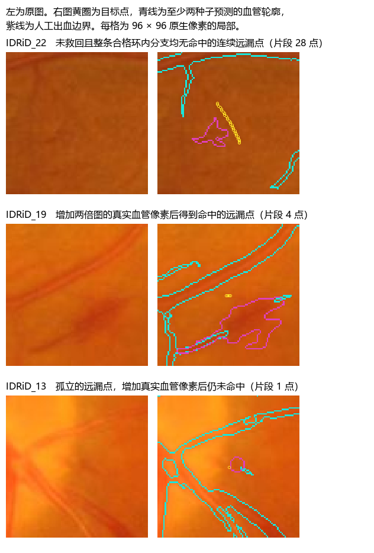

# 出血病灶邻域细血管研究归档

本项目要找回出血外缘附近的细血管。主指标是 11 像素外环内、宽度代理不超过 3 像素的骨架点召回，允许覆盖参考点或其上下左右一格，先在每张图内算比例，再按图等权。以下结果来自 Refined IDRiD v2 作者训练集上的三折、三个种子。54 张图中，51 张有目标细点，共 3,632 点；53 张可算邻域误报。患者双眼关系未知，官方测试集封存。

|推理方案|细召回|邻域每千像素误报|直接覆盖中心点|全图 Dice|
|---|---:|---:|---:|---:|
|增强四视图等权平均|54.02%|14.31|41.50%|79.67%|
|在疑似出血处调整尺度|55.00%|14.47|41.80%|78.93%|
|利用训练折内未见图的逐点得失学习添加|54.56%|14.32|41.73%|79.24%|
|只放宽原融合的阈值|57.68%|17.61|45.66%|79.75%|
|保留原融合，再加入 M0 仅两倍方案的命中|58.18%|17.65|44.46%|79.06%|

并集相对原融合多命中 4.17 个百分点，38 图提高、13 图持平。对照组在训练图上匹配并集的误报预算后，仅放宽阈值已提高 3.66 个百分点。两者直接配对差为 +0.51 个百分点，按图重抽样 95% 区间为 −0.66 至 +1.75。学习添加的真实标签与打乱标签分别得到 54.56% 和 54.64%。806 个三种子持续远漏点中，有 537 个连成 59 段，较高误报档的两掩膜并集只在至少两个种子中救回其中 48 个点。

## 按探索过程阅读

|阶段|材料|
|---|---|
|历史资产追证与任务定义|[历史 PR 审计与缺失资料](../near_path_preflight_20261121/README.md) · [PR #20](https://github.com/Yileina-Monv/retinal-vessel-study/pull/20) · [PR #21](https://github.com/Yileina-Monv/retinal-vessel-study/pull/21)|
|在 Refined IDRiD 上微调 U-Net M0，比较原尺寸、两倍和双尺度|[协议](../refined_idrid_20261121/PROTOCOL.md) · [结果与研究版模型](../refined_idrid_20261121/RESULTS.md)|
|2D nnU-Net 的尺度训练、困难采样、续训与纠错|[训练和推理对照](../nnunet_scale_20261121/模型训练与推理详细对照.md) · [训练、增强与跨架构融合](../nnunet_scale_20261121/细召回迭代对照.md)|
|四视图、八视图、区域选择与误报校准|[双视图与融合消融](../nnunet_scale_20261121/双视图与融合消融对照.md)|
|嵌套训练、打乱标签对照与持续漏段|[逐点验证](../nnunet_scale_20261121/switch_supervision/局部尺度选择结果.md) · [并集与同预算降阈值](../nnunet_scale_20261121/switch_supervision/union_budget/配对误报对照.md)|
|图像与误差审阅|[早期困难片段图册，下载目录后打开 HTML](../nnunet_scale_20261121/far_fragments/index.html) · [三图尺度得失](../nnunet_scale_20261121/family_scale_ablation/large_dual/paired_crops.png) · [局部选择器得失](../nnunet_scale_20261121/switch_supervision/paired_examples.png)|



## 权重与实验数据

[下载配套研究附件](https://github.com/Yileina-Monv/retinal-vessel-study/releases/tag/thin-recall-research-20261122)。ZIP 内保留仓库相对路径，解压到仓库根目录即可。每一种子独立评分，一次推理只需所选折、种子的一对主模型。三折三种子的分数取平均时需用全部九对。

|附件|内容与用途|
|---|---|
|`core-fold{0,1,2}-{2027,2028,2029}.zip`|每包是一份专项 U-Net M0 和一份 1,200 步纠错 2D nnU-Net。四视图、降阈值和二值并集共用这两份权重。|
|`control-fold{0,1,2}-{2027,2028,2029}.zip`|同一折、种子的普通 U-Net 微调 240 步、标准 2D nnU-Net 500 步、同错点采样及输入但移除额外监督的 2D nnU-Net 1,200 步。|
|`unet-refit-54.zip`|用全部 54 图训练的普通与专项 U-Net，供单模型研究推理。三折留出结果来自上述折内模型。|
|`routing-models.zip`|三折 RGB 区域分类器，以及三折学习局部得失与打乱标签的选择器。|
|`*-arrays.zip`|U-Net、nnU-Net 的逐图预测、评价数组及局部选择实验数据。含最新九组共 162 个留出图像/种子预测档，一档可同时存多种方法的掩膜。|

[文件位置与体积](files.csv) · [全部探索权重的角色与保留范围](weights.csv) · [附件字节数](assets.json) · [实验运行环境](../nnunet_scale_20261121/runtime.json)。清单中 `local-only` 表示仅留本地的消融或中间权重，对应的研究过程与已生成结果仍可查阅。

## 复核与使用

在归档环境安装对应依赖，从附件取出 `core-fold0-2027.zip` 并解压到仓库根目录。输入是已解码为 1024×1024 的 RGB 眼底图。下面是一张图用既有权重运行两种同预算方案的例子。

```shell
python outputs/nnunet_scale_20261121/predict_switch.py input.png union.png --fold 0 --seed 2027 --mode mask_union --point m0matched
python outputs/nnunet_scale_20261121/predict_switch.py input.png reference.png --fold 0 --seed 2027 --mode lower_reference --point m0matched
```

仅复算末轮已保存的逐图统计，可解压 `switch-arrays.zip`，并将作者的 `Train.tar` 放在 `outputs/refined_idrid_20261121/`，再运行 `report_switch_selector.py` 和 `report_union_budget.py`。运行全程无需打开官方测试包。训练用的环境目录和可重新生成的预处理缓存留在本地。需要从头重建 nnU-Net 缓存时，先在独立工作副本中将 `preprocessed/Dataset87*_RefinedVessel/ready.json` 归档标记改名，再运行 `prepare.py`。从头重新训练 U-Net 还需要原 FIVES 初始化 checkpoint，其身份记录在 `paired.py`。

图册的底图及参考标注来自 Sathit Intajag 与 Patama Bhurayanontachai 发布的 Refined IDRiD v2，研究图经过裁切、放大并叠加参考点和预测轮廓。原始训练包请从作者记录取得。[数据 DOI](https://doi.org/10.5281/zenodo.18676805) · [CC BY 4.0](https://creativecommons.org/licenses/by/4.0/)。
