# B1/B2公开误差图册

下载后打开[index.html](index.html)，可查看87幅对照。GitHub网页不直接运行HTML。

全部28图、原案例顺序和裁剪规则保留；84条整图TP/FP/FN记录与既有表逐项一致，140个GT/FOV/概率输入摘要逐一核对。未读RGB、Test，未运行模型。

绿TP、蓝FN、橙FP、黑TN、灰FOV外。显示缩放不参与计分；不是骨架d1命中图，也不是医学审核。

MAPLES-DR标注遵循原CC BY署名要求：[官方来源](https://liv4d.github.io/MAPLES-DR/en/)。

具有A7同结构Dev资产的授权组员可设置 `RETINA_PROJECT_ROOT`，运行 `python -B render_public_error_atlas.py > atlas.base64`；输出为ZIP的base64文本。此脚本只读取已登记Dev文件，不推理、不写服务器文件。公开克隆本身不含这些输入。

全图预览（点击查看，完整图册还包含局部与不利案例）：

### 20051116_44615_0400_PP

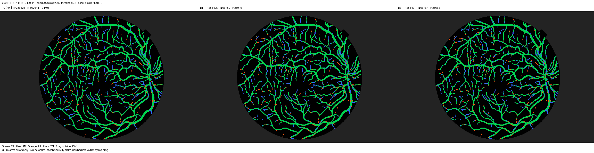

### 20051116_44785_0400_PP

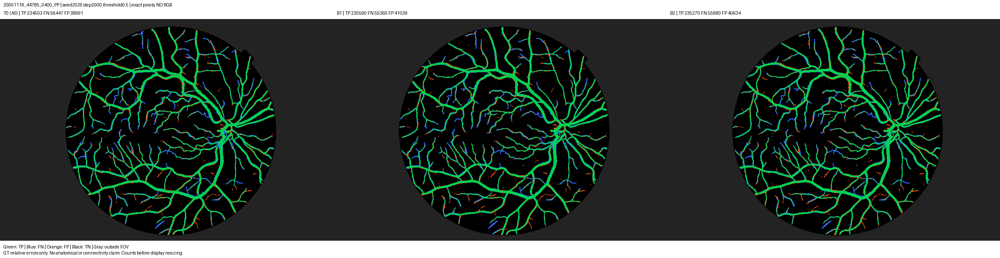

### 20051117_37078_0400_PP

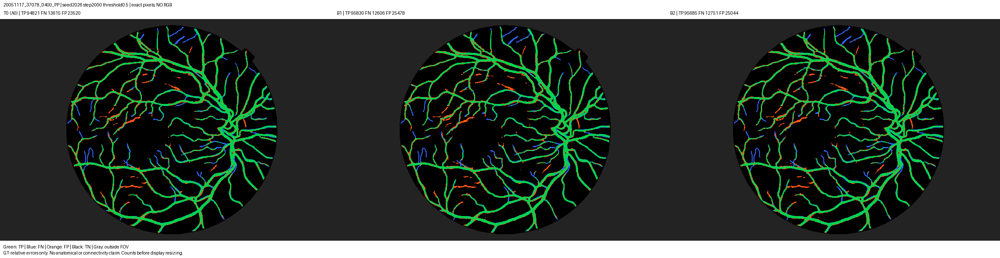

### 20051117_37130_0400_PP

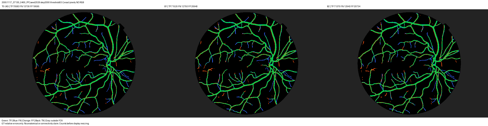

### 20051202_51655_0400_PP

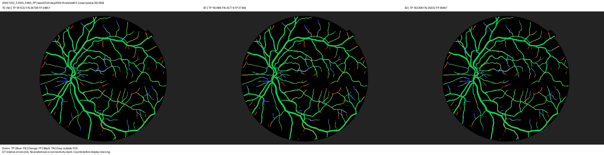

### 20051202_54530_0400_PP

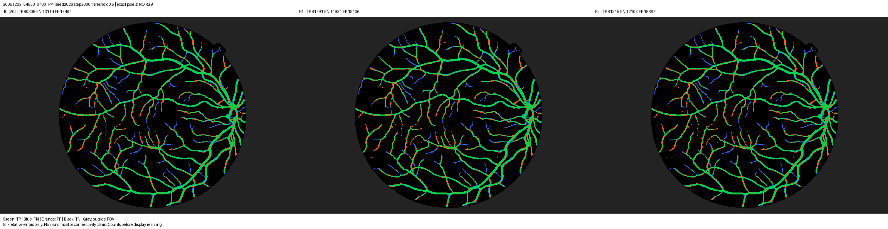

### 20051205_31934_0400_PP

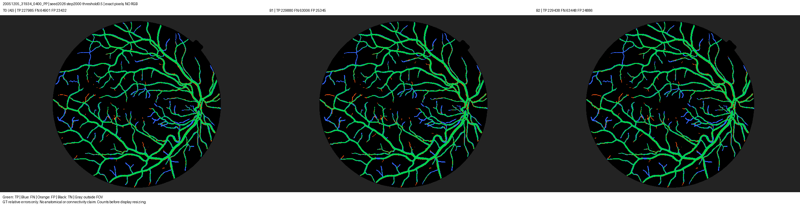

### 20051205_35224_0400_PP

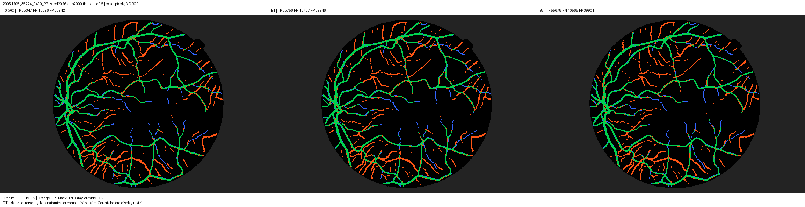

### 20051205_35276_0400_PP

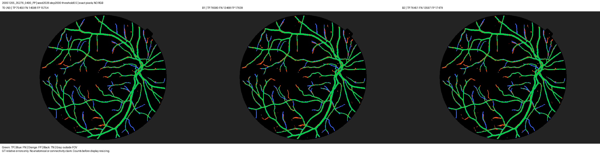

### 20051205_35305_0400_PP

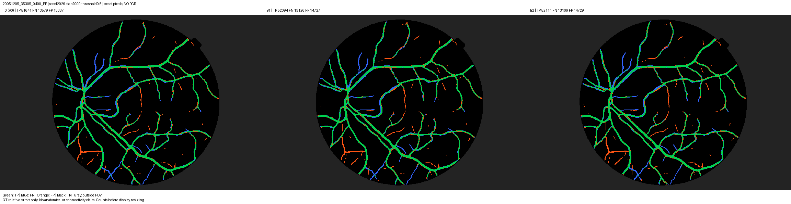

### 20051208_41707_0400_PP

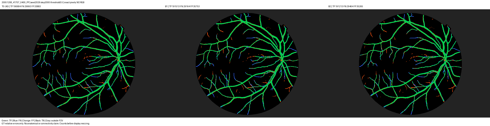

### 20060407_41937_0200_PP

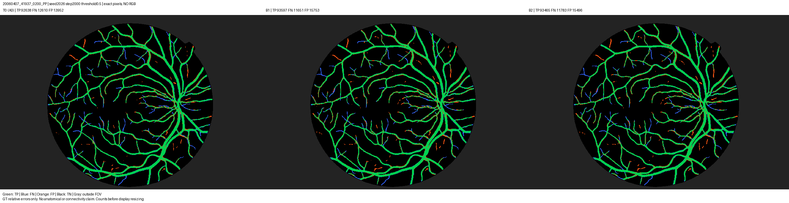

### 20060411_57853_0200_PP

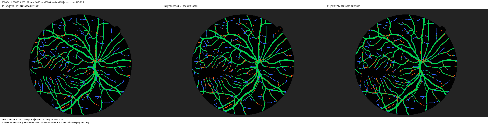

### 20060411_61214_0200_PP

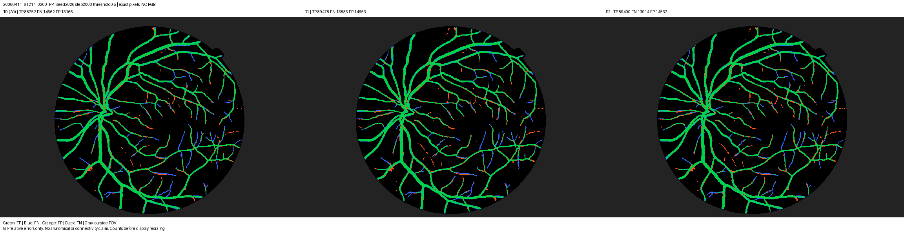

### 20060411_61478_0200_PP

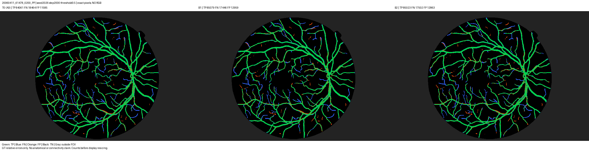

### 20060412_51656_0200_PP

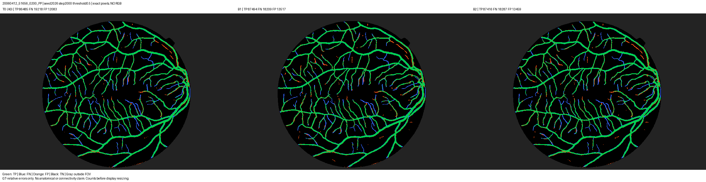

### 20060412_58287_0200_PP

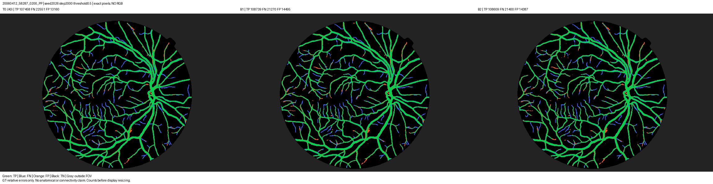

### 20060412_58889_0200_PP

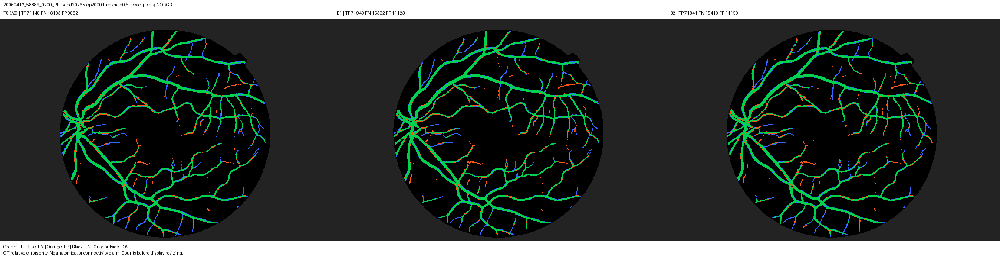

### 20060412_60913_0200_PP

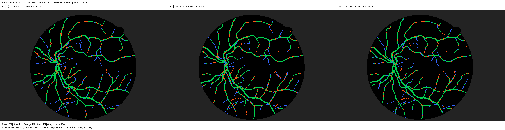

### 20060412_61299_0200_PP

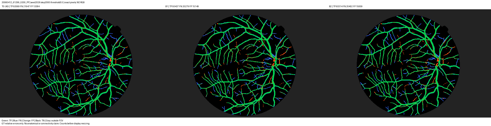

### 20060522_45248_0100_PP

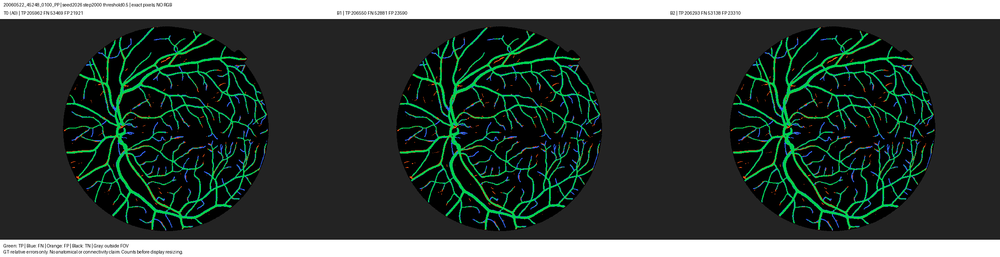

### 20060522_45583_0100_PP

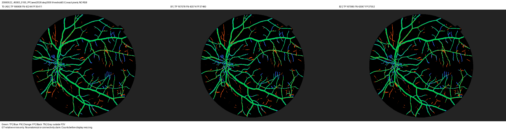

### 20060523_43038_0100_PP

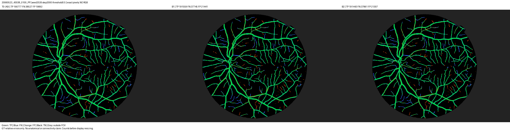

### 20060523_49859_0100_PP

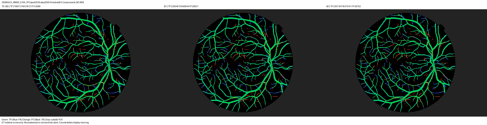

### 20060530_36895_0100_PP

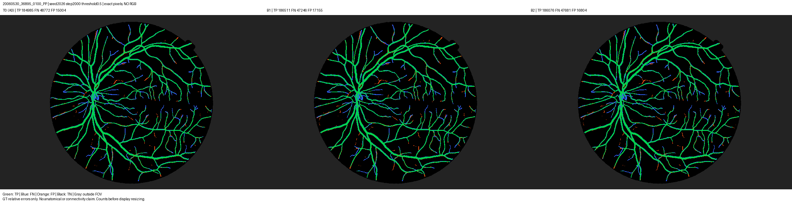

### 20060530_53062_0100_PP

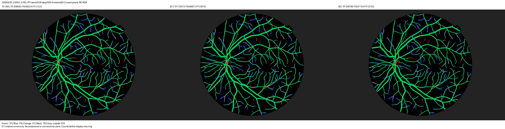

### 20060530_54390_0100_PP

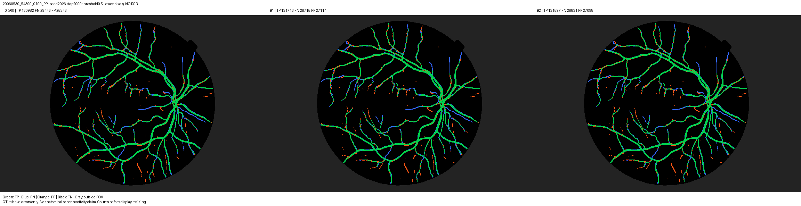

### 20060530_55390_0100_PP

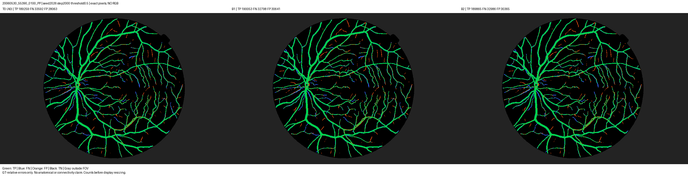
