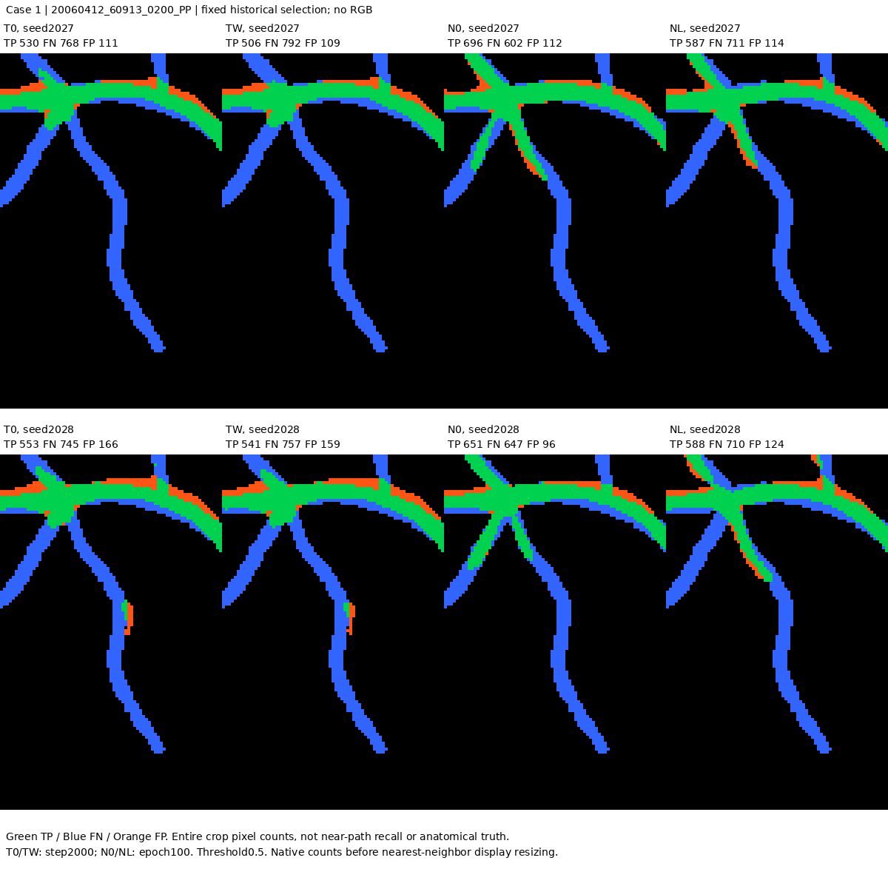
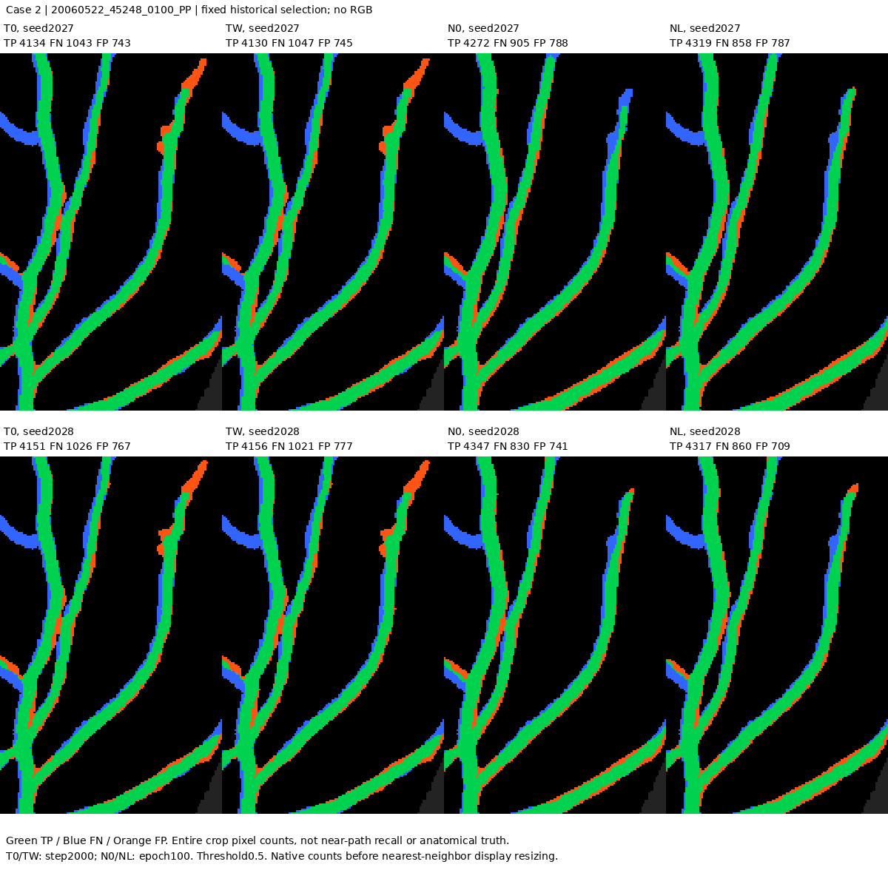
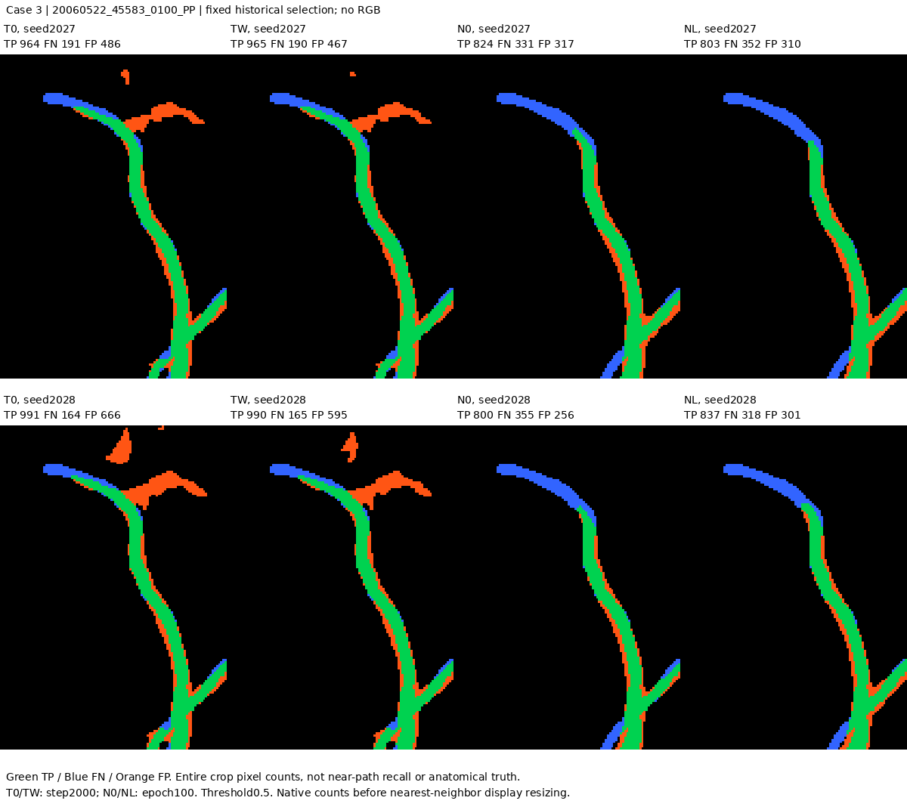
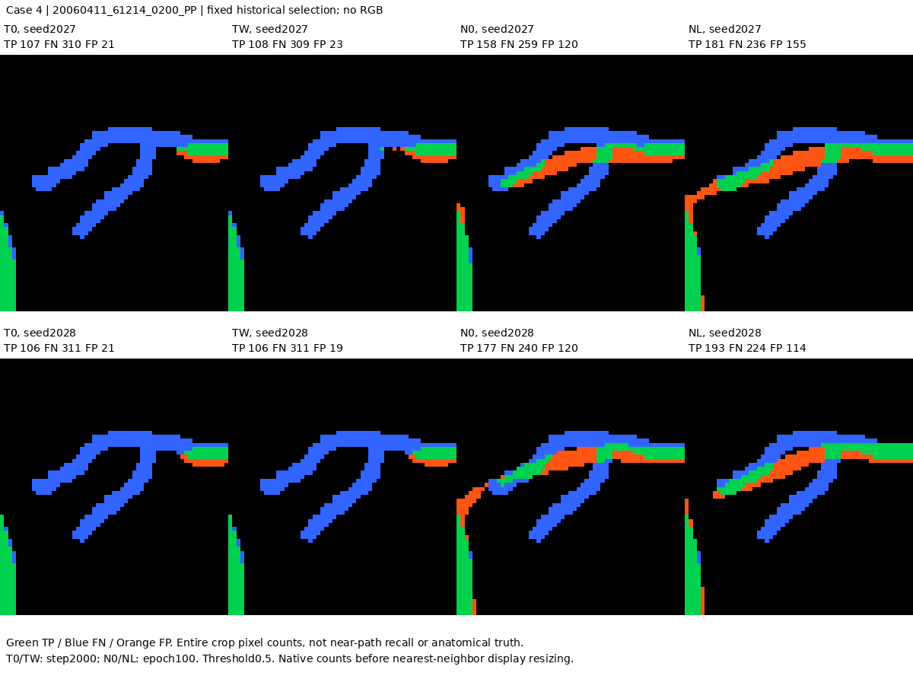
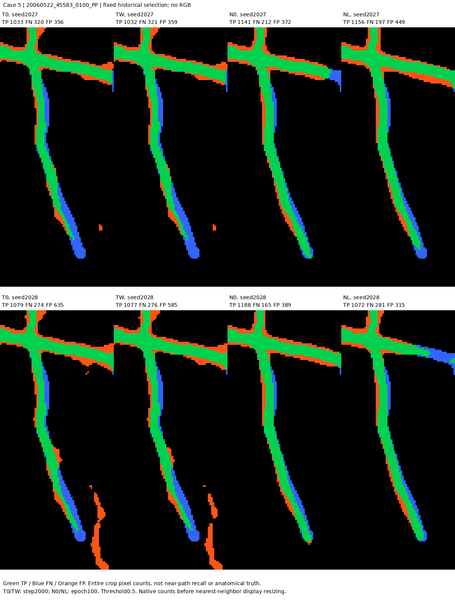
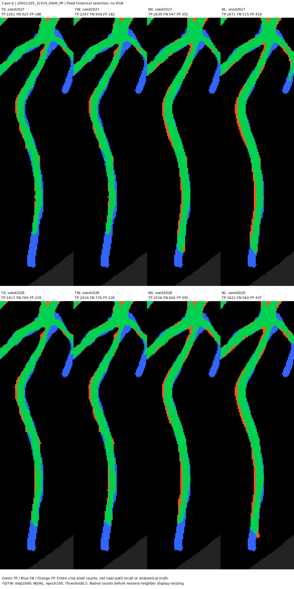

# T0/TW/N0/NL：原评价覆盖审查的6例对照

沿用原6例、原裁剪位置；每例同时呈现2027/2028两个seed，未按本轮表现换例。它们用于解释评价目标覆盖，不代表全部Dev28。

绿TP、蓝FN、橙FP；无RGB，不能判断标注医学真伪。数值是整个裁剪区内的像素计数，不是出血邻域骨架召回；T0/TW为2000步，N0/NL为100epochs终点，阈值0.5。整图Dice与FP/FOV共96项复核通过。

MAPLES-DR标注来源：Lepetit-Aimon等，2024，CC BY，[官方文档](https://liv4d.github.io/MAPLES-DR/en/)。

### 案例1：20060412_60913_0200_PP；原选择原因 single_target_image；裁剪yx=[381, 815, 501, 890]

### 案例2：20060522_45248_0100_PP；原选择原因 single_target_image；裁剪yx=[846, 1622, 1049, 1748]

### 案例3：20060522_45583_0100_PP；原选择原因 lowest_nonzero_candidate_coverage_in_size；裁剪yx=[783, 1581, 933, 1686]

### 案例4：20060411_61214_0200_PP；原选择原因 lowest_nonzero_candidate_coverage_in_size；裁剪yx=[819, 489, 883, 546]

### 案例5：20060522_45583_0100_PP；原选择原因 largest_near_candidate_with_zero_S3；裁剪yx=[559, 1562, 716, 1631]

### 案例6：20051205_31934_0400_PP；原选择原因 size_without_nonzero_S3_largest_near_candidate；裁剪yx=[1102, 1569, 1368, 1642]

