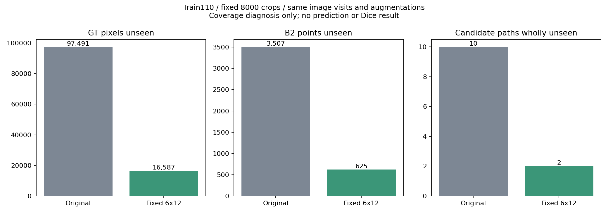

> 历史阶段报告归档；其中“下一步”“尚未授权”描述的是当时状态，不构成本轮实验授权。当前状态见本包总索引。

# 空间分层均匀裁块：唯一CPU候选审查

**结论：该候选通过预先设定的CPU准入，值得申请一组2000步训练验证。它尚未证明Dice改善，本次没有启动GPU或修改训练代码。**

## 这次改了什么

只在CPU中生成一个候选训练轨迹。保留原Train110的出现顺序、每图72或73次、总8000裁块、512原生尺寸及原draw的翻转/旋转。每图合法裁块左上角区域固定分6×12格，每格随机取一个合法位置，独立打乱72格访问顺序；原本出现73次的图再追加一个原分布均匀位置。

随机源固定为SeedSequence([2026,0x53504154,Train清单索引])；整数格边界为floor(k×合法坐标数/格数)。定义在统计候选结果前写入candidate_spec.json。不扫描格数、种子或多个规则，不用GT/Dev漏分位置选裁块。GT只用于事后检查覆盖。本次不实施生产采样器。

## 全110图结果

下表未覆盖像素/点按全Train池化计数；分母和逐图宏平均均在CSV与JSON保留。

| 项目 | 原采样 | 唯一分层候选 |
|---|---:|---:|
| 未覆盖GT∩FOV像素 | 97,491 | 16,587 |
| 未覆盖GT比例，分母18,056,654 | 0.5399% | 0.0919% |
| 未覆盖B2骨架点 | 3,507 | 625 |
| 未覆盖B2比例，分母989,358 | 0.3545% | 0.0632% |
| 完全没覆盖的候选路径，分母13,325 | 10 | 2 |
| 从未完整进入同一裁块的路径 | 116 | 29 |

**不利结果完整保留：13张图GT未覆盖量增加，5张图B2未覆盖量增加，19条路径联合点覆盖比例降低。**没有删除病例、重新选种子或改规则。全110张左右对照图按原清单排序。

## 为什么值得测试，哪些问题仍未解决

- 这次在完全相同裁块预算下减少了随机空间缺口；它改变覆盖规律，未刻意增加正样本权重。
- 每Crop平均血管比例为15.4107%→15.4137%，接近。不能把它称为训练标签驱动的血管过采样。
- 最小FOV为477→1386像素；FOV不足裁块面积1%的数量5→3；GT为空的裁块7→4。候选没有空FOV，没有拒绝/重抽裁块。
- 整数格尺寸略不相等，各位置边际概率与严格均匀采样的相对偏差上界为1.6733%。必须称近似保持均匀边际，不能称严格同分布或只改变顺序。
- 每图预算不变，因此**没有解决大图平均曝光更低、相对上下文更小的问题**。本次只检验空间覆盖；不同时改变图像权重、重采样尺度或裁块大小。
- 原覆盖已达99%以上，剩余缺口有限；Train覆盖收益不保证Dev Dice收益。候选按Train覆盖过一次预定准入，仍属于一种选择，不能包装为独立验证。图路径不是医学确认的解剖分支，原人工0/26保持。

## 推荐提交批准的GPU科学探索范围（尚未授权）

**只增加一条“原A0 + 固定分层裁块”轨迹，以既有原A0/T0为主要对照。**

- seed2026，原M0全新初始化，原U-Net、BCE+Dice、Batch4、512裁块、学习率/优化器/归一化/AMP/梯度裁剪保持；唯一主要变量为本文件固定的裁块原点轨迹。实际输入因此改变，不能冒称与A0的8000输入指纹相同；图像访问顺序、增强参数和预算配对。
- 固定2000次成功更新，失败/未知保留且不得清零或退款；不从任何工程权重续训。每200步按原协议完整评价Dev28，唯一主比较为2000终点、阈值0.5、图像宏平均普通Dice。不得选best、调阈值、扩预算或改变GT/FOV。
- Dice增量均值>0且预先沿用的整图配对bootstrap95%下限>0才称本轮探索有信号。保护与Dice信号分开判读：Precision/Recall/远处Recall/粗血管Recall/hard-clDice均值不利或FP/FOV均值上升不得称整体成功；原Precision及远处Recall区间下限、FP/FOV区间上限标准保持。细分支及旧病灶邻域结果/NA完整报告。
- 启动前完成新轨迹读取、源摘要、CPU原Loss接线一致性、数据与增强指纹、断点游标和恢复一致性检查；然后才可单独GPU放行。本次不替代该放行。稀小FOV裁块需在数值准入中特别覆盖；任何新GPU工程预算也必须明确审批，不能借用旧额度。
- 数值非有限、AMP跳步、OOM、来源漂移、预算/恢复游标不一致或资源违规立即停止，不自动重启；完整保存状态、日志和异常证据。单纯负cosine不能自动解释为发散；旧辅助Loss差值梯度ratio不能不加解释套用到相同Loss的新采样。
- GPU仅0、原UUID与共享锁，显存上限8GiB，GPU1禁用。可先按约3–4 GPU小时预留，属于粗估，启动前据实际入口和既有耗时复核；总步数固定不因时间估计变化而增加。本轮CPU耗时约125.4秒，不含GPU时间。
- 单seed重复Dev只能提供探索信号；有信号且保护通过后再单独申请2027/2028配对验证。失败则保留负结果并停止采样扩展，不反复搜索格数/种子。届时再设计一个网络模块的对照，不同时改Loss和多个模块。

## 验收与证据

所有8000原draw/图像访问和增强参数保留，全部原点合法；110图次数与FOV归一化系数守恒，三尺寸各原清单首图用直接切片算法独立核对。最终轨迹按预定RNG顺序独立重建8000项逐值一致，476个保护输入指纹未变。所有预先设定的CPU准入条件通过，但不等于科学训练已批准。

全部110图对照（历史A7原件：`all110_comparison.html`；本包未收录） · [8000固定轨迹](candidate_trajectory_8000.csv) · [逐图表](images_110.csv) · [全部候选路径](candidate_paths.csv) · [汇总和准入](comparison_summary.json) · [独立验收](independent_review.json) · [预先定义](candidate_spec.json)

## 研究方向记录

当前暂停继续搜索新Loss，转向训练采样方向。最新UFL固定设置未提高Dice支持此优先级调整，但不构成“任何Loss都无效”的证明。历史冻结协议及结论不改写。本次不交Luna实施训练，不访问Dev图像/Test，不运行模型，不更新任何权重。
