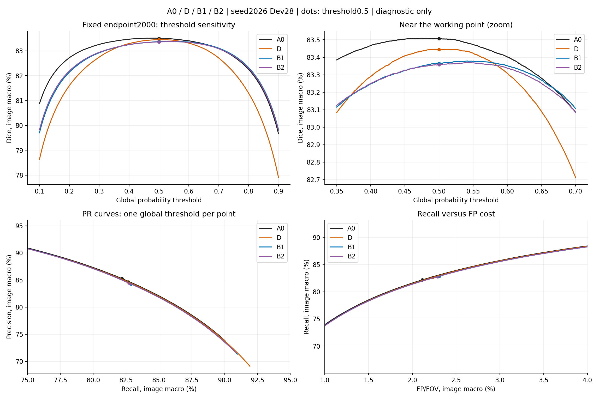
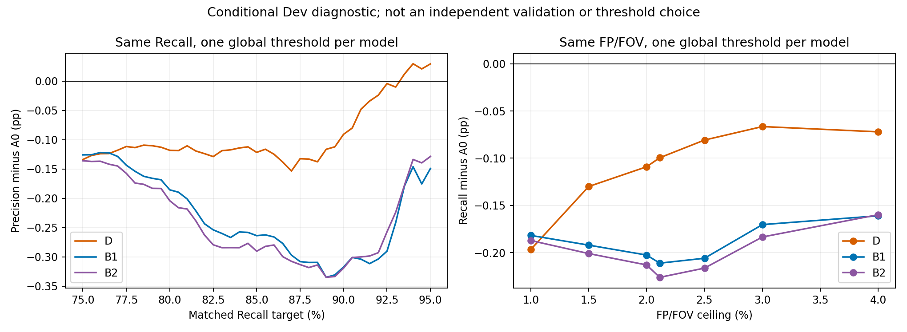
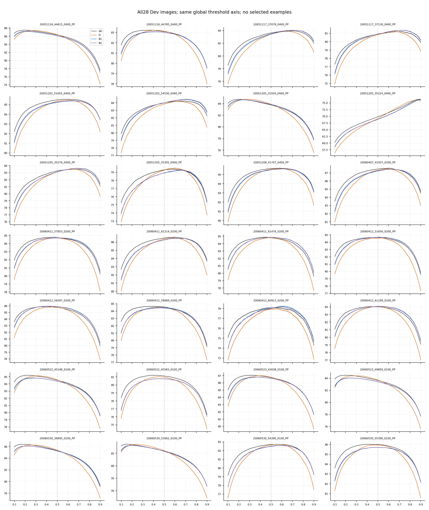

> 历史阶段报告归档；其中“下一步”“尚未授权”描述的是当时状态，不构成本轮实验授权。当前状态见本包总索引。

# 现有 U-Net 普通 Dice 瓶颈：概率、阈值与 FP/FN 诊断

## 结论先行

**不建议优先做阈值校准，也不建议马上换另一种 Loss。唯一首选是路线 C 中的一项 CPU 训练端诊断：检查固定原生512裁块和按图轮转采样造成的有效监督覆盖/尺度差异。** 目前还不能据概率图断定究竟是采样、特征能力还是标注限制占主导，因此先不指定新网络，也不启动 GPU。

本轮已复用112张终点概率图，未加载模型、未运行推理或训练。A0/B1/B2/D均为原U-Net、原M0、seed2026、固定2000步；Train110/Dev28及输入/增强顺序相同，三组候选各2000批/8000实际输入与T0逐值一致。GT、FOV、原生尺度、>=阈值及28图宏平均相同。B1/B2系数0.03；D固定gamma1，对称Focal BCE+原Dice，无soft-clDice项。

项目根目录本身没有AGENTS/STATUS，实际权威文件在既有code/retinal-vessel-study中；未新建根级状态文件。D阶段内部子目录沿用名称C，但指标method和科学phase为D，确认没有混用候选C权重。各历史实验的主指标、成功标准、负面结论均不改。

## 1. 我们的 Dice 为什么一直没有提高？

### 已经证实的是：找回的血管抵不过新带来的误报成本

以A0→D为例，固定0.5下像素池化TP净增20,782，FP净增31,771。像素总量不能替代图像宏平均；在每图用恒等式 `1−Dice=FN/(2TP+FP+FN)+FP/(2TP+FP+FN)` 分解后再宏平均：

|Dice损失的组成，百分点|A0|D|D−A0|
|---|---:|---:|---:|
|FN贡献|9.1119|8.8139|-0.2980|
|FP贡献|7.3818|7.7420|+0.3602|

因此D通过少漏检减少约0.2980个百分点的Dice损失，却因FP增加多付出约0.3602个百分点，净Dice下降约0.0622个百分点。这是指标的精确描述性分解，分母也随预测变化，不能当作网络内部机制的因果分解。

A0的Dice损失约55.2%来自FN、44.8%来自FP，两者都不能忽视。859,841个FN中55.3%的概率低于0.1，83.1%低于0.3；586,940个GT相对FP中72.2%的概率>=0.7。错误不只是挤在0.5附近的一层。约47.9%的FP距GT<=1原生像素，而约60.5%的FN距A0预测>1像素，支持漏分、误报及局部定位共同存在，不能全部归为边界增粗。

### 尚不能确认的原因

概率图不能独立证明：Loss是主要瓶颈、U-Net容量到顶、训练采样不足、标注漏标是主要原因，或某个新网络一定更好。GT外预测仍然只是GT相对FP；没有新增医学审核，原人工0/26/专家未知保持，不能把疑似漏标改成TP。

## 2. A0 和 D 的 Dice–阈值分析说明了什么？

四组统一扫描0.10～0.90、步长0.0001；辅助0～1同密度网格只用于匹配和范围核查。比较均用同一全体28图的统一阈值，不给每张图挑阈值。helper全范围最优点也均落在主扫描区间。

|模型|原0.5 Dice|探索性最佳统一阈值|同Dev最高Dice|较原0.5增益，百分点|
|---|---:|---:|---:|---:|
|A0|83.506%|0.4735|83.509%|+0.0030|
|D|83.444%|0.5106|83.445%|+0.0008|
|B1|83.365%|0.5414|83.379%|+0.0136|
|B2|83.358%|0.5448|83.371%|+0.0130|

**这些是反复使用Dev上的事后诊断上界，不是新验证成绩，不建议直接部署这些阈值。** A0最多只多约0.0030个百分点，D只多约0.0008个百分点；各自挑最有利的全局阈值，D仍比A0低约0.0643个百分点，28图中24图更低。原冻结0.5结果仍是唯一原实验结论。

### 相同 Recall：D没有换来更高Precision

目标为A0@0.5的Recall=82.1774%。每模型只用一个全局阈值匹配，残差保留、不插值伪造预测：

|模型|阈值|实际Recall|Precision|Precision−A0，百分点|
|---|---:|---:|---:|---:|
|A0|0.5000|82.177%|85.272%|+0.0000|
|D|0.5220|82.177%|85.147%|-0.1249|
|B1|0.5444|82.178%|85.026%|-0.2464|
|B2|0.5387|82.177%|85.008%|-0.2637|

### 相同 FP/FOV：D也没有找回更多GT血管

FP/FOV上限为A0@0.5的2.113795%，取满足上限的最低统一阈值；阈值网格残差在表中实际FP数值及CSV完整保留。

|模型|阈值|实际FP/FOV|Recall|Recall−A0，百分点|
|---|---:|---:|---:|---:|
|A0|0.5000|2.114%|82.177%|+0.0000|
|D|0.5266|2.114%|82.078%|-0.0995|
|B1|0.5574|2.114%|81.966%|-0.2111|
|B2|0.5526|2.113%|81.951%|-0.2261|

对齐工作点后，D与A0的差距确实缩小，但没有转成优势：同Recall下Precision仍低约0.125个百分点，同FP下Recall低约0.0995个百分点。说明固定0.5的取舍和额外的排序/识别差异同时存在；不能将缩小的差距当作严格的原因占比。

在Recall75%～90%的31个可精确匹配网格点上，D的Precision全部低于A0，差约0.091～0.153个百分点。高Recall约95%附近D有很小的交叉优势（约+0.029个百分点，条件图像区间跨零），所以不宣称全阈值严格支配。B1/B2在这一主要工作区间也没有优势。

### 校准好一点，不等于分得更好

|模型|精确AP图像宏平均↑|Brier↓|20-bin ECE↓|裁切NLL↓|
|---|---:|---:|---:|---:|
|A0|91.778%|0.038321|2.436%|0.141589|
|D|91.745%|0.037439|1.884%|0.134738|
|B1|91.726%|0.038565|2.279%|0.139753|
|B2|91.723%|0.038566|2.297%|0.139928|

AP是逐图按独特分数并列组精确计算的Average Precision再取宏平均，不是稀疏PR曲线的梯形面积，也不是把所有图像像素混池后的AP。D的AP低于A0约0.0327个百分点，22/28图更低；说明并非仅对分数施加了保持排序的严格单调平移。它不能进一步证明隐藏特征究竟怎样变化。

D的全FOV平均血管概率上升0.423个百分点，但GT血管上的平均概率反而下降0.141个百分点，GT背景上升0.528个百分点；约79.8%的GT血管像素分数下降、97.2%的GT背景分数上升。不能称为所有血管概率统一抬升。D同时改善Brier/ECE/NLL而Dice/AP下降，说明“校准诊断更好”不等于普通Dice更好。ECE受分箱、背景比例及GT局限影响，不能作为真实医学概率已校准的证明。

额外留一图内部敏感性检查：在其余27图拟合统一阈值，再评价留出一图，A0平均Dice较固定0.5反而低0.0592个百分点，D低0.0801个百分点。它不是独立验证，因为28图过去都已被观察；但不支持为了很小的同Dev阈值收益投入新的校准流程。

所有28图曲线与逐图结果均保留，不仅展示有利个例：

## 3. B1/B2 是否遇到了类似问题？

共同点：0.5下召回提高、Precision下降、FP增加；调阈值后的最佳Dice仍低于A0；同Recall/FP匹配后仍无优势。B1/B2的AP均值也略低，但图像区间跨零，不能把D的AP下降证据强度直接套在它们身上。

区别：B1/B2在选中正骨架处直接增加上推概率的监督，GT血管均值分别提高约0.640/0.549个百分点，GT背景也提高约0.427/0.382个百分点。D并非单向正骨架监督，GT血管均值下降且背景上升。相同的Recall/FP症状不能推出相同因果机制。

空间证据直接复用既有B1/B2报告，不重做图册：新增FP约76%～77%的像素距A0预测<=1原生像素，而距GT<=1只有约20%。本轮D新增FP为34,637、消除2,866；92.11%距A0预测<=1，距GT<=1为32.00%，约77.52%邻近A0已有GT相对FP。D新增FP面积前三图贡献约17.56%，不是单个大坏例驱动。

这支持已有响应的扩展/延伸包含相当多原本GT外响应，而不支持“全是GT边缘变粗”。距离、像素邻接与旧报告的“差集组件接触率”不是同一统计量，不混用。它们仍不能自动区分真实背景、漏标血管及医学未知。

## 4. 继续研究 Loss 有没有价值？

Loss仍有理论研究空间，但**目前不应作为下一轮优先投入**。本轮数据否定的是“现有B1/B2/D只差一个好阈值就能胜过A0”，并不否定所有Loss。原A0本身已直接监督前景和背景，粗血管Recall很高而低分细支漏检与高分GT外响应同时存在；简单继续加强正样本、继续扫gamma/alpha，缺少当前证据支持。

|路线|判断|依据|
|---|---|---|
|A 阈值校准|不优先|同Dev乐观上界收益极小，内部留一图也无收益；没有尚未参与选择的独立校准/评价数据，Test仍封存|
|B 新Loss|暂缓|现有候选在主要PR工作区间无改善；Tversky尚未被这些结果否定，但不能据Dev曲线选FP/FN系数或直接上复杂Loss|
|C 训练/网络策略|首选训练端诊断，暂不指定新网络|共同骨干/M0/训练流程还未被这几种Loss改变，概率数据无法定位是曝光、尺度、特征还是标注；先补一项能定位训练短板的CPU证据|

## 5. 下一步唯一建议：Train端有效监督覆盖审计（待批准）

**研究问题：按图轮转、固定原生512裁块，在三种原生尺寸下是否让部分FOV/现有细分支目标长期没有或较少受到有效监督？** 这是待证伪的训练策略假设，不是已发现的Bug，也不是已证明的Dice主因。

本轮相关阶段索引和报告中未找到全量实际裁块曝光图；已经完成的8000输入/增强及目标变换一致性核对不重做。输入一致只说明配对公平，不等于每个GT像素受监督机会均匀。

给Luna的最小待批任务仅一项：复用已有Train110 GT/FOV/目标缓存与A0的8000条draw/裁块几何，CPU恢复每个FOV像素被裁块覆盖的次数，以及原BCE的FOV归一化曝光代理。后者不是实际参数梯度，不将Dice项梯度从几何中伪造出来。按既有三尺寸、细/粗目标和完整候选分支统计零覆盖比例、曝光分位数、逐图细/粗比及完整覆盖图；不从Dev漏分位置制造新标签。

控制变量：A0模型、Loss、权重、样本、增强及预算全部不动，不新增推理；不重选宽度、路径、阈值或Checkpoint。仅用Train缓存；若缓存缺失先报告，不自行改FOV或标签定义。本次权限只用Dev开展上述诊断，**Train内容审计仍待用户另批，本轮未读取Train原图/GT执行该任务，未向Luna派发。** 无需GPU，按图流式处理，预计数十分钟CPU，具体取决于缓存。

完成/失败标准：必须覆盖110图和8000draw、保留全部分母和零覆盖，曝光总和与8000裁块实际FOV计数精确对账，FOV外权重为零、变换与冻结规则一致；不能通过删掉低曝光图片完成对账。未对账、来源漂移或缓存不足即停止并报告。若没有覆盖缺口或稳定的尺寸/细粗曝光短板，明确记该假设未获支持，不因急于训练就改采样或换网络；发现差异也只能作为申请一个采样/尺度单变量试验的依据，不能声称已证明其导致Dev错误。

CPU审计完成不等于Dice成功。任何后续GPU研究均需另行方案与批准，预先冻结普通Dice配对改善和现有Precision/FP等保护条件；不自动扩大种子、不扫Loss、不访问Test。

## 技术证据与局限

- 新数值扫描约96秒，峰值RSS约477MiB，112概率图与28份Dev参考前后SHA未变；0模型前向/0训练/0GPU。
- 原0.5逐图448项数值误差为0；旧七阈值表4116项检查一致；12个按原生尺寸预选案例的精确AP由第二算法核对；三候选全部2000批/8000输入与A0一致。
- bootstrap为固定图像对的条件区间。最佳阈值/匹配点来自同一已反复使用Dev，区间没有校正选择乐观性，也不包含seed/患者不确定性；不据此作独立显著性或临床结论。
- 细分支、clDice及原病灶邻域的历史评价继续保留；新主阈值曲线只诊断普通Dice/P/R/FP，不替换旧指标或成功标准。
- [概率分布与校准图](probability_calibration.png)、完整逐图阈值CSV（历史A7原件：`per_image_threshold_metrics.csv.gz`；本包未收录）、[统一阈值汇总CSV](threshold_curves_macro.csv)、[同Recall/FP逐图条件比较](matched_operating_points.csv)、[逐图固定阈值误差分解](fixed05_error_decomposition.csv)、[统计摘要](diagnostic_summary.json)、[独立复核](independent_validation.json)、[配对可比性](comparability_review.json)。
- 前序误报和clDice研究直接复用原 `scientific_b1_b2_2000_v1_20261022/analysis/fp_error_analysis_v1/` 及 `literature_mechanism_review_20261023/`；未重复文献搜索、未覆盖旧报告。
