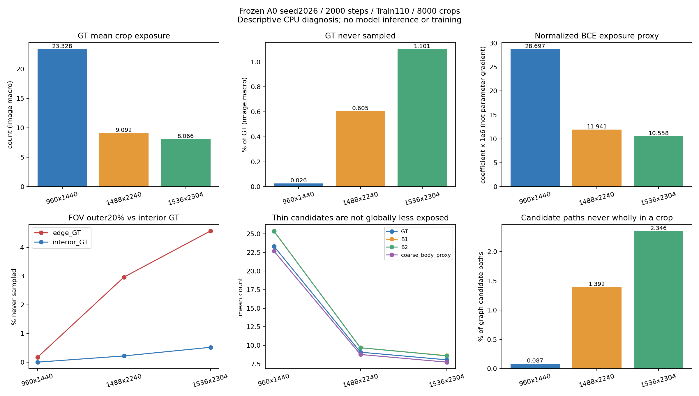

> 历史阶段报告归档；其中“下一步”“尚未授权”描述的是当时状态，不构成本轮实验授权。当前状态见本包总索引。

# Train110 实际裁块覆盖与尺度诊断

完成时间：2026-10-25T00:05:50.769391+08:00。执行与审查：Sol；复用已有 A0 seed2026 固定2000步的8000次实际裁块。

## 先给结论

**没有发现“大部分细分支没有参与训练”的问题；发现了尺寸相关的覆盖频次差异和少量边缘覆盖缺口。它们值得一次受控采样探索，但不能据此认定是普通 Dice 的主要瓶颈。**

- GT/FOV 内血管像素至少出现一次的比例为 **99.4601%**；分母 18,056,654，未覆盖 97,491。这是像素池化比例，与逐图均值分开报告。
- B2候选细分支骨架点至少出现一次为 **99.6455%**；分母 989,358，未覆盖 3,507。
- 13,325 条候选图路径中，13,209 条（99.129%）至少有一次完整进入同一裁块；116条未整段进入。全部路径的轴对齐包围盒均能装入512裁块；不能把“能装下”与“已经采到”混淆。
- 86条路径存在至少一个从未覆盖的骨架点，其中10条从未覆盖。这些是既有GT图路径代理，不是经过医学确认的完整解剖分支。

## 按原生尺寸的实际结果

下表均为组内逐图均值。未覆盖率的分母为各图 GT∩FOV；“BCE系数”是累计像素系数代理，单位10⁻⁶，不是参数梯度。

| 原生尺寸 | 图数 | 每图裁块 | 血管平均出现次数 | 血管未覆盖率 | 边缘血管未覆盖率 | BCE系数 |
|---|---:|---:|---:|---:|---:|---:|
| 960x1440 | 58 | 72–73 | 23.328 | 0.0259% | 0.1686% | 28.697 |
| 1488x2240 | 33 | 72–73 | 9.092 | 0.6052% | 2.9676% | 11.941 |
| 1536x2304 | 19 | 73–73 | 8.066 | 1.1010% | 4.5757% | 10.558 |

### 可以确认的事实

1. 当前采样按图轮转，每图72或73个原生512裁块，未随分辨率增加裁块数。小尺寸血管的平均出现频次约为最大尺寸的2.89倍；BCE像素系数代理约为2.72倍。
2. 同一尺寸内，B1/B2目标的平均曝光不低于现有粗血管体部代理。因此不支持“全局细骨架因采样普遍更少而失败”的解释。
3. 采样代码按原规则从合法整数左上角均匀取样。解析期望曝光与实际组均值接近，未发现几何或尺度实现错误。未覆盖位置通常在边缘更多，也有个别图像的内部缺口。
4. 每Crop按FOV归一化会提高FOV较少裁块中的像素系数；大尺寸图的边缘GT平均系数甚至高于内部。因此“出现次数少”不能直接等同“训练梯度弱”。
5. 按图相同预算本身是合理研究设计，与图像宏平均评价有联系；按原生像素强行等权并不天然更公平，也可能改变不同病例的权重。

### 尚不能确认的因果解释

- 原生512裁块在大尺寸图中覆盖的相对视野更小，可能改变上下文；但没有测量实际特征、感受野利用或因果效果。
- Train覆盖缺口不能直接解释Dev错误，也不能转换成预期Dice增量。未训练过某个Train位置不等于模型不能泛化到它。
- 本轮不证明模型容量不足、某个模块必然有效、Loss已无研究价值或标注存在医学错误。
- 完整路径曝光不等于预测连接恢复；原人工记录仍0/26，医学真实性未知保持。

## 唯一优先的后续建议：先比较空间分层均匀裁块，暂不加模块

**建议先申请一个仅改变裁块位置生成方式的对照，而不是增加正样本权重、延长训练或堆模块。此处只是研究提案，尚未实现或放行。**

研究假设：在相同8000裁块预算下，使每图采样位置更均匀，能减少随机覆盖缺口，而不刻意强调血管或背景、也不重新定义Loss。这主要检验空间覆盖，不能同时解决或声称解决分辨率差异。

候选规则：保留原110图顺序和每图72/73次出现；将每图合法裁块左上角区域划为6×12个整数非空格，每格均匀抽一个位置，独立打乱72格访问顺序；需要第73次的图增加一个原分布均匀位置。训练前一次性用seed2026及固定图索引生成并锁定整条轨迹。原draw对应的翻转与90度旋转参数保持，GT不参与选位置。每格整数范围须按floor(k*R/n)确定，R为合法坐标数量。由于格大小可相差1，该规则近似保持均匀边际；变化及最大偏差必须在CPU验收报告明示，不能称严格同分布。

最低成本准入：仅CPU生成该一条候选轨迹，与原轨迹比较全110图覆盖、FOV有效量、完整路径可见性和增强来源；同时报告平均次数不一定改善、边缘缺口不一定消失及所有不利病例。若全量未覆盖GT、候选骨架点和零覆盖路径不能同时减少，或裁块合法性/FOV/配对来源不合格，则不申请此候选GPU；不继续在Dev上优化采样规则。

若CPU准入通过，再单独申请seed2026从原M0开始、2000成功更新的A0采样对照。U-Net、原BCE+Dice、Batch、学习率、优化器、AMP、固定评价步骤及0.5阈值保持；只有crop位置及其派生输入指纹变化，不能宣称原8000输入逐值配对。只复用原A0作探索对照，输入日志和增强参数必须保存。GPU成本暂以原A0实测配置估计，启动前据CPU及原训练耗时另交预算，不在本轮放行。

新研究以普通Dice为首要目标；候选训练前冻结图像配对不确定性及原Precision/Recall/FP/FOV/粗血管/远处召回/clDice保护，细分支与旧邻域完整报告。固定2000终点、不择best、不改阈值；单种子重复Dev只提供探索信号。初筛不利即保留负结果，不自动扩种子；有信号且保护通过再申请2027/2028配对。

如覆盖候选不能通过CPU准入，或一次预先冻结的GPU探索没有Dice收益，停止采样方向扩展；再提交单个网络上下文模块的独立方案。届时说明原M0兼容、附加参数初始化和模块关闭一致性，不同时换Loss或多个模块。当前数据不足以负责任地指定某个注意力模块必然更优。

## UFL已有诊断复核

复用并独立对账16/16组合、96次梯度、零更新。UFL−A0梯度范数/A0范围0.6318–0.7860；UFL总梯度/A0范围0.2472–0.3795；总梯度方向cosine范围0.9035–0.9993。
AMP梯度相对误差最大1.464%，最小cosine=0.999893，显存预留峰4492MiB。

UFL替换整个Loss，delta近乎与A0反向主要反映总梯度缩小；这与“新增正样本辅助项抵消A0”不是同一种含义。范数缩小不自动等于AdamW更新按同比例缩小，更不证明Dice改善。已有UFL工程授权及后续状态以其独立现行记录为准；本任务不修改其release、账本或启动任何GPU。

## 方法、验收及可复核产物

- C(p)=Σ1[p在原生裁块内]。W(p)=Σ1[p在裁块内]/(4×该Crop的FOV像素数)。W仅对应A0 BCE像素系数，不包含logit误差、Dice非局部梯度或参数Jacobian。
- 解析期望：每轴计数为max(0,min(p,L−512)−max(0,p−511)+1)，除以合法左上角数，两轴相乘再乘该图裁块数。未覆盖期望=(1−单次包含概率)^次数，不是结果显著性检验。
- 边缘：按每图FOV内欧氏距离变换的最低20%（含阈值并列）定义，仅为探索诊断。不是新冻结评价半径，不用于训练目标或宣称医学区域。
- 原8000裁块的FOV、V、V∩FOV、B1、B2计数共40000项与旧表精确一致；110图次数/归一化权重守恒通过。三尺寸各取清单首图，用独立直接切片算法核对次数和权重通过。输入471个指纹未变。
- CPU主分析耗时149.2秒、进程RSS峰1272.6MiB；没有GPU调用、新模型前向或参数更新，没有读取Dev图像或Test内容。

全110图固定顺序热图（历史A7原件：`all110_coverage.html`；本包未收录） · [逐图结果](images_110.csv) · [分层数据](strata_per_image.csv) · [全部候选路径](candidate_paths.csv) · [8000裁块计数](crops_8000_reused.csv) · [独立验收](independent_validation.json) · [UFL复核](UFL_diagnostic_reconciliation.json)

原冻结协议、历史负面结论、原始数据和所有权重不变。本报告的新采样候选待用户审查；未向Luna下达新任务。
